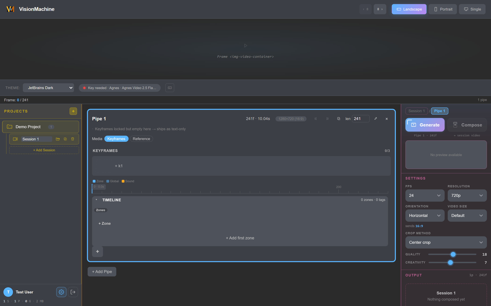
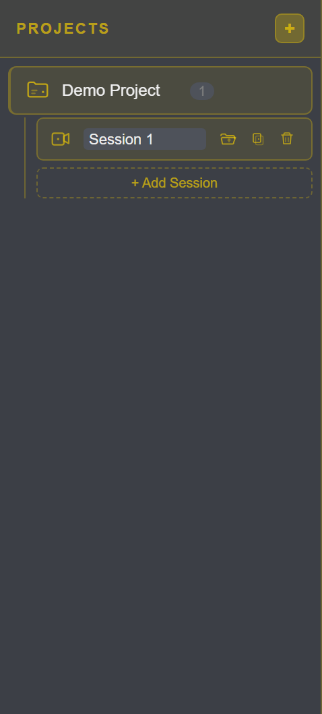
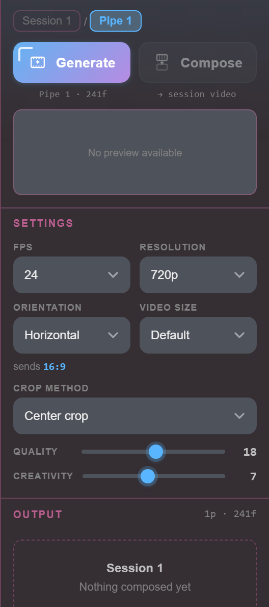
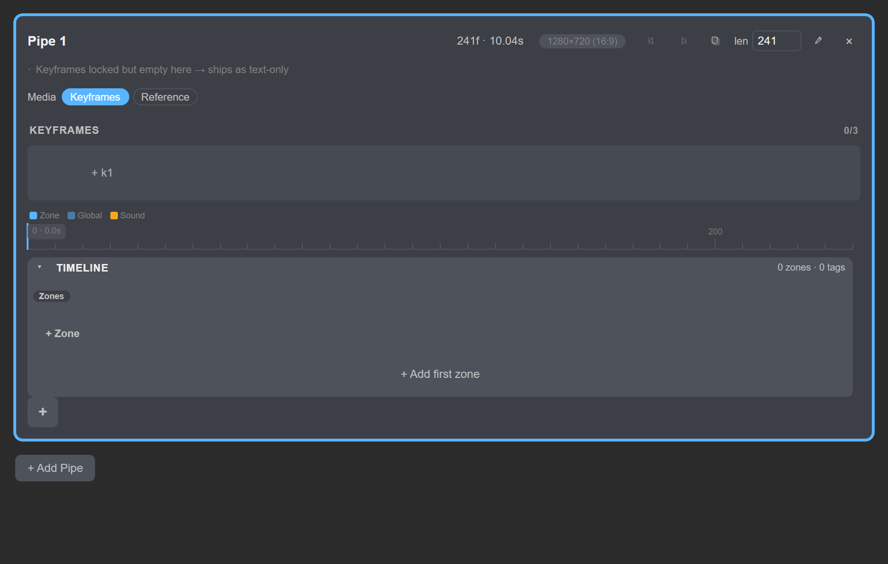
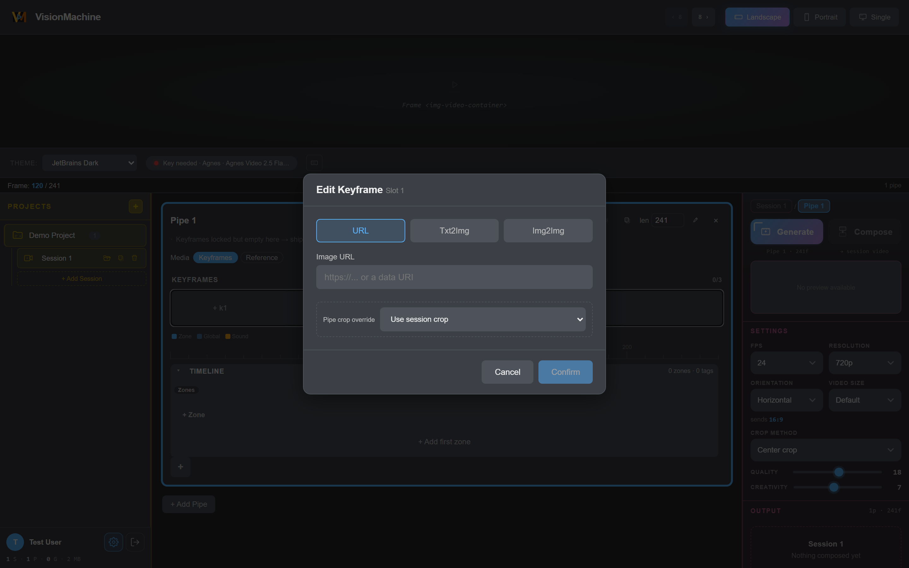

# VisionMachine

**Free, local, director-style AI video studio.** Design your video shot by
shot — keyframes, camera moves, lighting, effects — on a real timeline, then
watch every frame generate against its own seeded instructions, and compose
it all into one finished clip. Runs on your machine. No subscription, no
per-frame fees.

<p align="center">
  
</p>

## Why VisionMachine

Most AI video tools give you a prompt box and a dice roll. VisionMachine
gives you a **composer** — the same way a video editor gives you a timeline:

- **Direct every shot.** Lay out keyframes, then stack tags on the timeline —
  scene, camera, rotation, lighting, effect, zoom, transition — and per-zone
  prompts. What you see is what gets generated: each zone of the final
  video is built from its own instructions, seed, and model.
- **Inspect every frame of the result.** The top preview panel shows the
  generated video next to the frame ruler — scrub to any frame and see
  exactly which prompt and settings produced it. No black box.
- **Controlled, reproducible generation.** Seeds are first-class: every
  generation is logged with its parameters, so you can rerun a shot and get
  the same result back.
- **Resilient to shaky infrastructure.** Built around the free Agnes model
  engine: the app polls generation jobs to completion, handles provider
  outages gracefully, and never loses your work to a dropped connection.
- **Everything is managed locally.** Projects, sessions, keyframes,
  references and generation history live in a local SQLite database —
  fast, private, and portable. Your footage never has to leave your disk.
- **Compose into one video.** Pipes connect end to end into a single
  finished sequence — the killer feature: from scattered shots to one
  coherent piece.

<details>
<summary><b>How it works — a 60-second mental model</b></summary>

1. **Project → Session → Pipes.** A project holds sessions; a session is
   one video; the video is built from one or more pipes (sequential shots).
2. **Keyframes** (up to 3 per pipe) set the visual anchors — paste a URL,
   generate text→image, or transform image→image.
3. **Segments and tags** on the timeline describe *how* the shot moves —
   camera pans, zooms, lighting shifts — each zone with its own prompt.
4. **Generate** compiles everything into per-zone prompts (quality,
   creativity, seed, model of your choice) and runs the jobs with live
   progress.
5. **Preview & compose.** Watch each pipe in the top panel, then join pipes
   into the finished video.
</details>

## Get the app (Windows)

| | |
|---|---|
| **Latest release** | [**v0.7.7 — download MSI**](https://github.com/hi4c0ck/visionMachine/releases/latest) |
| **System** | Windows 10/11, x64 |
| **Install** | Run the MSI. SmartScreen will show an *"unknown publisher"* warning — the build is not code-signed yet. Click **More info → Run anyway**. |
| **Provider access** | Free Agnes generation is built in; for other providers, set a base URL + API key in **Settings → Providers** (see [docs/agnes-model-catalog.md](docs/agnes-model-catalog.md)). |

[Releases page](https://github.com/hi4c0ck/visionMachine/releases) ·
[What's new in v0.7.7](https://github.com/hi4c0ck/visionMachine/releases)

## A quick look

Here's what you'll see in the app — each image shows one moment from a
real workflow, so you can picture the flow before you start.

**The full workspace** — composer timeline in the center, settings/tools
on the right, your library on the left, profile anchored bottom-left:

<p align="center">
  
</p>

**Your library** — every project and session you create, gold-tinted with
the new app-chrome icons, ready to open again:

<p align="center">
  
</p>

**The tools panel** — the progressive hero: a focus breadcrumb
(Session / Pipe), the Generate & Compose actions, and the settings grid:

<p align="center">
  
</p>

Ready to try it? Jump to [Try it in 5 minutes](#try-it-in-5-minutes).

## What's new in 0.7.7

The 0.7.x line focused on a tighter composer, first-class media controls,
and a custom icon language. Highlights:

- **Progressive focus in the tools panel.** A clickable *Session / Pipe*
  breadcrumb walks you up and down the focus level; the hero shows the
  right Generate/Compose actions for whatever you're focused on, and the
  pipe-level Generate carries a subtle corner notch to distinguish it.

- **Subject references you can preview & cite.** Reference images live
  inline in the pipe; click one to open the shared **lightbox** (zoom +
  pan), or insert it into a prompt as a `[SubjectN]` token from the
  reference strip in any prompt modal.

- **Precise media controls.** Resolution presets are filtered to what the
  selected video model actually supports, an orientation-aware
  **video-size** picker clamps to the model's declared limits, and image
  pieces auto-invalidate when the target size changes. Per-pipe **crop**
  override and preemptive downscaling of oversized local images keep
  generation honest.

- **A custom app-chrome icon set.** 50 hand-drawn marks in the Atlas
  gold language replace ad-hoc unicode glyphs across the panels, so the
  whole UI reads as one system.

<details>
<summary>More 0.7.7 screenshots</summary>

| Composer pipes | Keyframe modal | Settings |
|:--:|:--:|:--:|
|  |  |  |

</details>

## Try it in 5 minutes

1. Install the MSI (or `npm run tauri dev` from source).
2. Enter your name — that's your local account; everything stays on disk.
3. **Create project → add session.** The composer opens with one empty pipe.
4. Add up to 3 **keyframes** (URL / txt2img / img2img).
5. Add a **segment**, drop **tags** on it (camera, lighting, …), set the
   zone's prompt, then **Generate** and watch progress.
6. Scrub the result in the top panel — every frame traceable to its
   instructions.

Deeper usage: see [Usage](#usage) below.

## Tech under the hood

- **Frontend**: Svelte 5 (runes), TypeScript, Vite
- **Backend**: Tauri 2, Rust, SQLite — the database is the source of truth
- **Styling**: CSS custom properties (dark/light theming)

## Getting started (developers)

| Goal | Path |
| --- | --- |
| **Just use the app** | Download the MSI from [Releases](../../releases). No toolchain needed. |
| **Modify / recompile / contribute** | Build from source (below). |

### Prerequisites

- Node.js 18+ (CI uses Node 20)
- Rust stable toolchain with the **MSVC** target
- WebView2 (preinstalled on Windows 10/11)
- Tauri CLI (`npx tauri` works)

### Build

```bash
npm install
npm run tauri dev      # run the desktop app
npm run tauri build    # build a local MSI → src-tauri/target/release/bundle/msi/
npm run dev            # frontend only (browser dev mode, localStorage)
```

### Project structure

```
src/
├── components/
│   ├── App.svelte          # Main app with welcome screen
│   ├── Workspace.svelte    # 5-container layout orchestrator
│   ├── Frame.svelte        # Top header with preview
│   ├── ProjectsPanel.svelte # Left sidebar - projects/sessions
│   ├── ProfilePanel.svelte  # Bottom-left user info
│   ├── ComposerPanel.svelte # Center - pipe timeline editor
│   └── ToolsPanel.svelte   # Right sidebar - settings/generate
├── types/
│   ├── app.ts              # Core data models
│   └── composer.ts         # Type re-exports
└── constants.ts            # App constants and presets
```

## Usage

### Creating your first project

1. Launch the application
2. Enter your name on the welcome screen
3. Click "Create Project" in the left sidebar
4. Enter project name and optionally specify path
5. Click the "+" button under your project to add a session
6. Select the session to open the composer

### Working in the composer

- **Add keyframes**: Click "+" in the keyframe row (max 3)
- **Set global prompt**: Click the global prompt bar
- **Add segments**: Click "+ Add Segment" to add type-specific sliders
- **Adjust settings**: Use the right panel for FPS, resolution, quality, creativity

### Data storage

- Database (source of truth) at `%LOCALAPPDATA%\com.visionmachine.desktop\visionmachine.db`
- Projects/sessions also cached to `localStorage` in browser/E2E mode (no Tauri backend)
- Logs at `%LOCALAPPDATA%\com.visionmachine.desktop\logs\`

## Documentation

- [Composer timeline rules (SLA)](docs/composer-timeline-sla.md) — the 8-frame
  engine floor, the ≈1s zone guideline, and the tag composition model
- [Agnes model catalog](docs/agnes-model-catalog.md) — supported models,
  limits, and URL configuration
- [Release notes](release-notes.md)

## Contributing

See [CONTRIBUTING.md](CONTRIBUTING.md) for development setup, the branch
model, and how to submit issues and pull requests.

- [Code of Conduct](CODE_OF_CONDUCT.md)
- Issue templates: [Bug report](.github/ISSUE_TEMPLATE/bug_report.md),
  [Feature request](.github/ISSUE_TEMPLATE/feature_request.md)
- [Pull request template](.github/PULL_REQUEST_TEMPLATE.md)

## Releases

Prebuilt Windows MSI installers are published to [GitHub
Releases](../../releases) from the `production` branch. A tagged
release (`vX.Y.Z` on `production`) triggers the build-on-tag workflow in
`.github/workflows/release.yml`.

## Branch strategy

- `develop` — active development branch
- `production` — stable releases only
- Feature branches created from `develop`

## Troubleshooting

### White screen issue
Check browser console for errors. Common causes:
- Missing type exports
- Reactivity issues with $state/$derived
- Component prop mismatches

### Database errors
- Ensure app data directory is writable
- Check logs at `%LOCALAPPDATA%\com.visionmachine.desktop\logs\`

### Build failures
- Clear target directory: `Remove-Item src-tauri\target -Recurse -Force`
- Rebuild: `npm run tauri build -- --debug`

## License

**VisionMachine** is licensed under **GPL-3.0-or-later**, with an attribution
addendum. © 2026 @Horizones Machines.

Full license text: [LICENSE](LICENSE) · quick guide: [NOTICE.md](NOTICE.md)

### Third-party dependencies & bundled components

Most of the runtime stack is compiled into the app and covered by its own
permissive license (MIT / Apache-2.0 / BSD). The full-variant installer also
bundles one standalone third-party program:

| Component | Source | License | Ships in |
|-----------|--------|---------|----------|
| FFmpeg + ffprobe (sidecar) | [BtbN/FFmpeg-Builds](https://github.com/BtbN/FFmpeg-Builds), tag `autobuild-2026-10-11-13-04` | GPL-2.0-or-later (FFmpeg core, dual LGPL-2.1-or-later; GPL-enabled build incl. x264/x265) | full variant only (tiny variant ships no binary) |

The bundled FFmpeg sidecar is distributed as a separate, unmodified
executable and carries its own GPL source-offer duty. See the **FFmpeg
Source Offer (GPL §6 compliance)** section in [NOTICE.md](NOTICE.md) for the
full source-offer statement, and
[src-tauri/binaries/NOTICE.txt](src-tauri/binaries/NOTICE.txt) for provenance
and SHA-256 verification.
