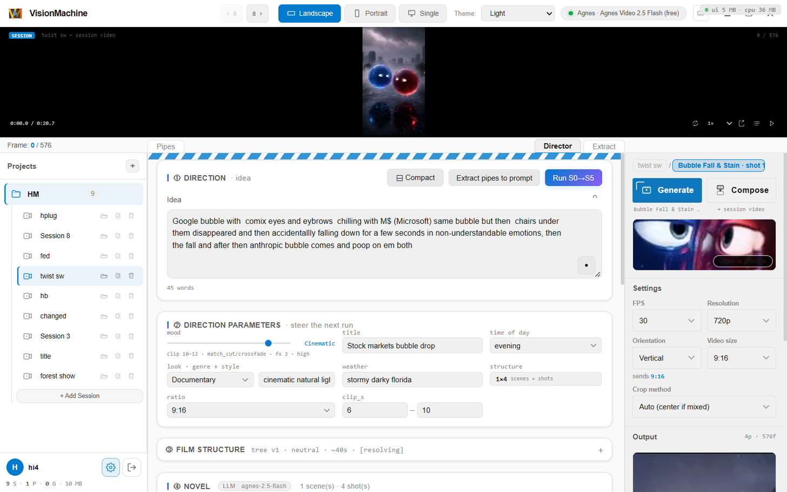

# Director Mode — User Manual

VisionMachine v0.7.11 · Director mode turns a short creative idea into a
verified set of composer pipes — one pipe per shot — through a chain of
steps you can watch, re-run, and apply. It speaks the language of a film
set: slates, takes, script pages, and cue sheets.

> Screenshots marked **capture pending** are filled from the live app in the
> final release pass; the layout described is the shipped v0.7.11 layout.

---

## 1. Opening Director

Select a session. Above the composer sit three tabs: **Pipes**,
**Director**, **Extract**. Open **Director**.

A diagonal clapper stripe runs across the top of the Director panel —
that's the slate. Everything below it is the production. The panel is five
numbered blocks:

| Block | What it holds |
|---|---|
| **① DIRECTION · idea** | Your creative premise — the ground truth every later step traces back to |
| **② PARAMETERS** | The look controls: style, ratio, scale, time of day, weather, mood |
| **③ FILM STRUCTURE** | The structural tree: driver, runtime, branch roles, energy, temperature arc |
| **④ NOVEL** | The written story — scene cards with sluglines and numbered beats |
| **⑤ STEP CHAIN** | The run itself: steps, status lamps, take line, run log |

## 2. Setting up a run

In **① DIRECTION**, type a short premise, e.g. *"a red fox darts through the
tall pine forest at dusk"*.

In **② PARAMETERS**, set the look:

- **Style / genre**, **aspect ratio**, **time of day**, **weather**.
- **Scale** — scenes × shots-per-scene × clip seconds. This is your *goal
  length*: the engine treats it as the runtime budget and resolves the
  actual counts from your content — a dense idea earns more shots.
- **Mood slider** — Subtle ↔ Balanced ↔ Cinematic. The mood sets the look
  band (clip length, transitions, effects, contrast). Since v0.7.11 it no
  longer dictates pacing by itself — see §6.

### ③ FILM STRUCTURE

The collapsible structure card shows the resolved plan before you run: the
driver character, target runtime, branch roles (open / develop / close),
energy bars, and the chained color-temperature arc. You can pin manual
overrides — driver, scene count, shots per scene, target seconds,
per-branch transitions — and the run honors them. The
`driver · target ~40s · auto 3×3` badge is live data: the exact scale the
run will use.

The **export / import** chips save and load the whole setup as a shareable
seed file.

<!-- SCREENSHOT PENDING: director-structure.png — ③ FILM STRUCTURE with pins -->

## 3. Running — ⑤ STEP CHAIN

Press **Run S0→S5**. The ⑤ STEP CHAIN heading becomes a slate take line:

- **TAKE K** — the flow version of this run (every run is kept; takes never
  overwrite each other).
- **{frames}f · 24fps · {runtime}s** — the verified totals.
- A rotated **↻ RETAKE {step}** stamp appears when the take is a re-run from
  a specific step.

While the run is live, a film-leader ring spins in the heading and each step
row carries a **tally lamp**:

| Lamp | Meaning |
|---|---|
| 🟢 green glow | step verified ok |
| 🟠 dim amber | untrained stub (an honest placeholder, not a failure) |
| 🔴 red | step failed |

The steps run in order — intent, expand, structure, critic, lower, verify —
and the run log streams progress so nothing looks frozen, including while
the novel is written. The chip on **④ NOVEL** tells you which path wrote it:
the LLM (when a text provider is configured) or the deterministic template
fallback, which always works.

<!-- SCREENSHOT PENDING: director-running.png — ⑤ STEP CHAIN mid-run -->

## 4. Reading the result

### ④ NOVEL — the script pages

Each scene renders as a script-page card: uppercase mono slugline, a
**REV {K}** revision stamp, the prose in a comfortable reading column, and
numbered beats with accent ticks. Shot counts and hand-off lines carry the
continuity between scenes.

### One pipe per shot

The run materializes **one composer pipe per shot**, lengthed to that shot's
own clip — no dead tails. Each pipe's timeline is a set of **window zones**:
every story beat gets its own window with its scene, camera, lighting,
motion, and transition tags nested inside at their own sub-ranges (new in
v0.7.11 — previously everything collapsed into one long block). The prompt
sent to the video model preserves that nested structure.

### Applying to the composer — regenerate

The **regenerate** chip opens a two-choice menu:

- **replace** — rebuild the composer pipes from this take (destructive; the
  menu shows which flow version will replay).
- **append** — keep the existing pipes and add the new ones.

### Extract — the cue sheet

The **Extract** tab lists every section of the plan as a cue-sheet row.
Alongside the full text (never truncated) you get department chips:

- **SC / CAM / LGT / MOT / TRN / FX** — which department the cue belongs to
- **4500K** gel chip with a luminance dot on lighting cues
- **35mm** lens chip on camera cues
- **→ fast** motion vector glyph + speed on motion cues

From here you can copy all, save, or diff against a previous take.

<!-- SCREENSHOT PENDING: director-extract.png — Extract tab with cue-sheet chips -->

## 5. Re-runs

Every step row offers **re-run from here**: only that step and the ones
after it execute again. The take line shows the RETAKE stamp, the previous
take stays intact, and you can diff the two in Extract. Use it when one
stage of the plan looks wrong — you don't pay for the whole chain again.

## 6. Pacing that reads your intent (new in v0.7.11)

Motion is no longer a fixed band stamp. The engine resolves the run's
**dynamics** from context:

- **Info density** — how many story beats you pack per second of your goal
  length. A sparse, long goal → *narrative* pacing (slow moves, long holds).
  A dense, short goal → *kinetic* pacing (fast moves, short holds).
- **Intent** — action words in your idea/style (chase, thriller, escape…)
  raise the energy one level; calm words (quiet, portrait…) lower it.
- **Mood** — the Subtle band stays restrained; a high mood no longer forces
  slow crane moves on everything.

In kinetic runs the motion layer is **staggered** against the camera window,
so the layers shift against each other — the dynamic feel a trailer needs —
instead of moving in lockstep.

## 7. Persistence

Everything survives a restart: your idea, parameters, mood, structure pins,
every take (they coexist as versions), and the timeline preview. Reopen the
session and the Director is exactly where you left it.

## 8. Troubleshooting

| Symptom | What it means |
|---|---|
| Amber lamps on critic steps | The critic model is untrained — scores are honest stubs, not failures |
| The novel chip says "template" | No text provider answered (the run log records why); the template result is always valid |
| A take looks wrong | Diff it against the previous take in Extract, or re-run from the offending step |
| regenerate is disabled | Run the chain first — there is no plan to apply yet |

---

*Related: [Session Generation & Progress](session-generation.md) ·
[Director technical reference](../director-mode-how-it-works.md)*