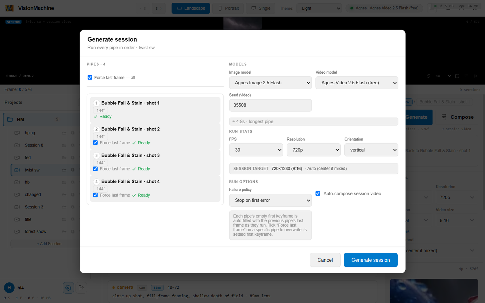
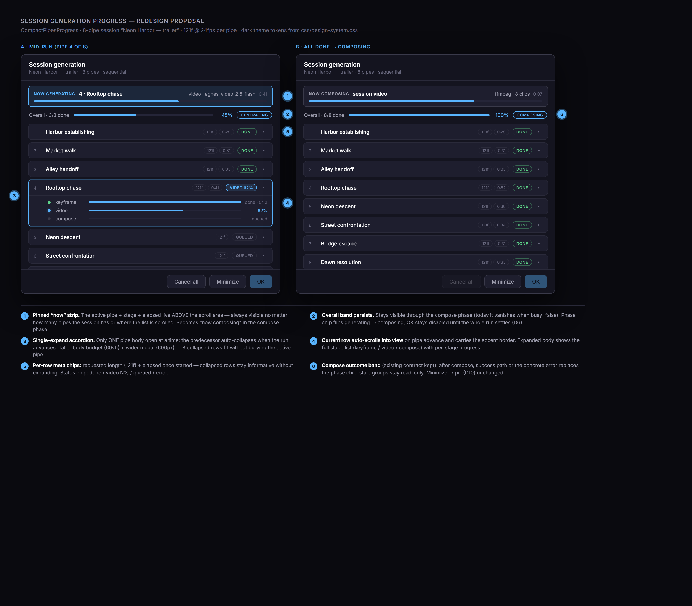

# Session Generation & Progress — User Manual

VisionMachine v0.7.11 · How to generate a whole session of pipes and follow
the run without losing track of any pipe.

---

## 1. Starting a session generation

Open the **Generate session** action in the tool panel. The generation box
lists every pipe in the session with its own row:

- **Include checkbox** — pick which pipes run this time.
- **Force last frame** — overwrite the pipe's settled first keyframe with the
  previous pipe's last frame (the continuity catch).
- **Boundary trim (experimental)** — drop the model's first-frame settle
  interval off this pipe's clip head when the session video is composed.

### Check-all masters (new in v0.7.11)

Above the pipe list, two master controls flip **every** pipe at once:

- **Force last frame — all** (tri-state: shows a dash when pipes disagree)
- **Boundary trim — all** (appears when the experimental trim gate is on)

Individual rows still override the master afterwards.

Press **Generate** — the run starts with the session's current settings.
(The Quality/Creativity knobs were removed in v0.7.11: the provider ignores
them on almost every route, so they only added noise. Keyframe generation
uses fixed sensible values behind the scenes.)

## 2. Following the run — the redesigned progress view

The session progress modal was rebuilt in v0.7.11 so a 10-pipe session never
buries the pipe that's actually working:

*Design frame: A — mid-run (pipe 4 of 8); B — all pipes done, composing.
The shipped view follows this layout.*

### The pinned "now" strip

Above the scrolling list, a highlighted strip always shows the **active
pipe**, its current stage (keyframe / video), live percentage, and elapsed
time — no matter how long the list is or where you've scrolled. When the run
moves to composing, the strip flips to **"Now composing · session video ·
ffmpeg · N clips"** with a pulsing bar.

### The Overall band

`Overall · 3/8 done · 45%` with a phase chip (**generating → composing →
done**). It stays visible through the compose phase — it used to vanish the
moment generation finished. The **OK** button stays disabled until the whole
run (including compose) settles, so you can't close over a half-finished
session.

### One pipe open at a time

The list is a single-expand accordion:

- The current pipe auto-expands and **scrolls into view** when the run
  advances; the previous pipe collapses automatically.
- Click any row to inspect its full stage list (keyframe / video / compose
  with per-stage progress); opening one closes the others.
- Collapsed rows stay informative: index, name, **length chip (121f)**,
  **elapsed chip** while running, and a status chip (done / running N% /
  queued / error).

### Minimize

**Minimize** shrinks the modal to a pill so you can keep working; the run
continues and the pill tracks it. **Cancel all** stops the run.

<!-- SCREENSHOT PENDING: session-progress-live.png — live mid-run capture replacing the design frame -->

## 3. After the run

- Each pipe's preview **updates in place** the moment its generation lands —
  no reselecting, no stale thumbnails (fixed in v0.7.11 for both pipe and
  session previews, including after keyframe confirmation).
- The session video composes automatically when the group finishes; the
  progress view shows the compose phase and the concrete outcome (ready
  path, or the actual error — never a fake success).
- To compose manually — or compose only *part* of a session — use the
  **Compose** action: pick the pipes and set each boundary cut
  (−24…+8 frames; negative trims the previous pipe's tail, positive the new
  pipe's head, 0 = lossless splice).

## 4. Troubleshooting

| Symptom | What it means |
|---|---|
| A row shows "rate-limited" | The provider is throttling; the run waits and retries — the elapsed chip keeps ticking so you know it's alive |
| Compose shows an error band | The clips are safe; the band carries the concrete ffmpeg reason |
| OK is disabled after generation | Compose is still running — the Overall band's phase chip shows it |
| Stale group note | A persisted run outlived its tasks (e.g. after a crash); the view is read-only and says so |

---

*Related: [Director Mode](director-mode.md) ·
[Session generation plan](../session-generation-plan.md)*